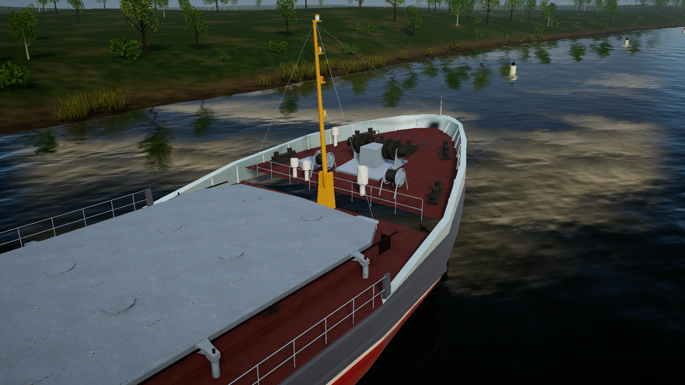
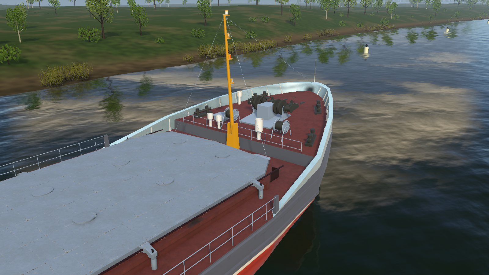

# Forecastle step repair, 2026-10-29

The two triangles closing the raised forecastle beneath the forward mast faced
into the forecastle. Back-face culling exposed the water when viewed from aft.
The wall already had the correct vertices; its winding and corner shading normals
needed reversing. The same defect existed in both reduced-detail hulls.

`repair_forecastle_step.py` selects the wall by its authored position and checks
its area (13.744 square metres). `part8_export.py` runs this idempotent correction
before deriving LODs. The editable blend and all three shipped FBX files include
it. Six triangles in total changed orientation; no vertices or UV coordinates
changed. `bow-step-comparison.json` records the comparison with the original
five source scenes. Re-encoding custom corner normals introduced a maximum
0.000212 unit-vector difference on unchanged faces. Materials, collisions and
hydrostatic geometry are unchanged.

Before:

After:

## Verification

`VolgoDonBowReview.Validate` checks imported triangle winding, shading normals and
wall coverage in all three prefab LODs. Its EditMode regression test passed as
part of the 331/331 suite. `VolgoDonBowReview.Run` captures both sides at every
LOD into `Logs/BowGap/`; all six corrected captures were inspected.
Run with graphics enabled using `-executeMethod ShipSimulator.Editor.VolgoDonBowReview.Run`.
The capture uses URP's single-camera render request, avoiding the cold-start
`Camera.Render` error seen in the first baseline frame. The baseline starboard
image above rendered successfully; the failed black port frame is not evidence.

The existing standalone executable must be rebuilt to include the updated FBX.

Full PlayMode: 189/189 passed in
`check-PlayMode-20261029-001859-746.xml`. Fleet shakedown passed:
`check-Shakedown-20261029-002529-578.log`. No standalone rebuild was performed.

## Part 6 follow-up, 2026-10-30

The previously pending standalone rebuild is now available at
`build/BowReview/ShipSim159.exe`. See the
[grounded bow review](../../../Assets/ShipSimulator/Documentation/UsabilityPart6Review.md)
for editor/player loading, grounding, trim and LOD evidence. The source repair
above is unchanged.
