# ShipSim159 Project Status

Updated 2026-10-29. ShipSim159 is a Unity river navigation prototype for Windows,
with six playable vessels and a seventh selection combining the Serpukhov tug
with the passive MN-52 barge. This page describes the current implementation,
not the September prototype. Historical milestone results remain in their reviews.

The simulator is **not validated for maritime training or real navigation**.
Hydrodynamics, underwater geometry, depths, currents and equipment parameters
include documented estimates. Passing automated tests does not validate those
estimates against a real vessel.

## Current capabilities

| Area | Implemented state |
|---|---|
| Engine and platform | Unity 6000.6.0f1, URP 17.6.0, Input System 1.20.0; Windows, keyboard and mouse |
| Fleet | Volgo-Don 507B, Volgo-Balt 2-95A/R, Volgoneft 1577, Meteor 342U, Luch 14352, Serpukhov R-96, and Serpukhov + MN-52 |
| Passages | Gorodets reach (default), river familiarisation and Serpukhov zaton; vessel/formation admission limits apply |
| Vessel motion | Force-driven Rigidbody motion, MMG manoeuvring, engine/shaft response, current, wind, restricted water, buoyancy and grounding |
| 507B equipment | Compartment cargo/ballast/stores, load-dependent draft/trim, visible nominal bulk, animated shafts/rudders/hatches/windlasses, anchors and mooring |
| Push unit | Separate passive barge Rigidbody, joint coupling, own buoyancy/resistance/contact and saved formation state |
| Interface | Scalable 80-150% UI, independent 75-115% panel size, hidden/tab/pinned controls, compact icon bar and localized hints |
| Languages | Live English, Russian, German and Spanish; translated UI, hints and gameplay messages; persistent selection |
| Camera | Nine views, independent saved orbit/zoom sensitivities, proportional wheel zoom and unscaled smoothing, navigator model eye, legacy-save migration |
| Navigation | Heading-up channel map, depth zones, route, buoys, obstacle footprints, track, predicted path and waypoint |
| Persistence | Start/pause menu, vessel/passage choice, one voyage save with atomic replacement and backup, persistent user settings |
| Sound and graphics | Shared sound library with vessel profiles; water/wake/propeller wash, weather, day/night, sector lights, TAA and vegetation LODs |
| Distribution | [v0.1.3](https://github.com/WiverNz/ShipSim159/releases/tag/v0.1.3) was published by the linked Actions run; the CI corrections described below follow that published build |

## Interactive map, 2026-10-29

Part 4 adds 100-4000 m map range, wheel zoom, expanded panning, Follow ship,
heading-up/north-up and a legend. Engines remain permanently accessible. The map
uses scene fairways, waterlines, buoy positions and current mission goals with one
projection. Display choices persist; restore/reset recentres the chart.
See [the Part 4 review](UsabilityPart4Review.md) for tests, three-scene captures and limits.

## Volgo-Don forecastle wall, 2026-10-29

Fixed reversed triangles beneath the forward mast in the source model and all three
LOD exports. The wall now renders from aft instead of exposing water. Vertex positions,
UVs, materials and physical geometry are preserved. Checks: 331 EditMode tests,
189 PlayMode tests, six close-up captures and the fleet shakedown passed.
See [the source review](../../../Art/Source/VolgoDon507B/BOW_STEP_REVIEW.md)
for before/after images. Existing player binaries require a rebuild for this correction.

## Adaptive HUD and display settings, 2026-10-28

The engine telegraph and head-up map now have separate permanent areas at the lower left
and right. The own-vessel marker and all seven engine commands remain visible across tool
tabs and scrolling. Old hidden preferences cannot remove these essential controls. Other
tools use the left drawer above the engines; the central view stays clear. Small windows
cap HUD zoom, fit the map independently and wrap astern/stop and ahead controls into rows.

Settings > Display offers resizable window presets and native borderless fullscreen.
The chosen window size and mode persist across launches. Fresh installs start fullscreen;
existing mode preferences and explicit Unity startup screen arguments are respected.
Oversized windows fit the current monitor's working area. The fallback window is now
1280x720 instead of a fixed 1024x768. See [OperatorGuide.md](OperatorGuide.md#window-size-and-fullscreen).

Verified: 330/330 EditMode, 189/189 PlayMode, seven-selection fleet shakedown, and a Windows
development player built with zero errors and warnings. The UI matrix covers four languages,
eight resolutions (including 800x600 and 960x540), and three paired global/panel scales.
Assertions check essential-panel visibility, on-screen bounds, no overlap, a visible own-ship
marker, reachable scroll contents and unclipped text. The actual Windows player passed
800x600, 1024x768, 1280x720, native 1920x1080 fullscreen and return to 800x600, including all
six tool tabs and ahead/astern/stop button commands. A requested 1920x1080 window fitted to
1888x968 on the test monitor, leaving room for the taskbar and frame. This is automated UI
verification, not a claim about subjective handling or maritime validation.

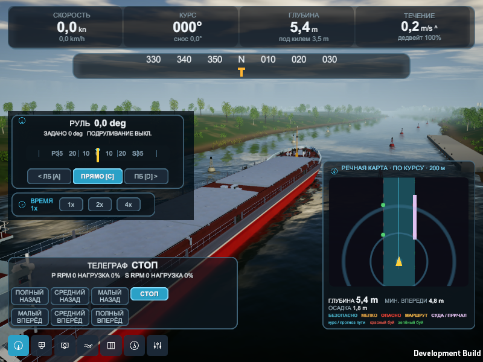

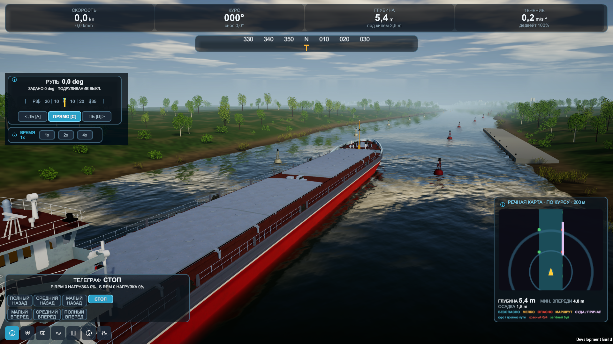

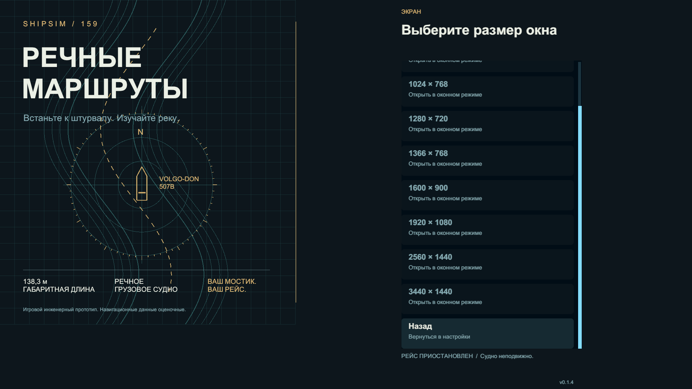

## Fleet screenshots (2026-10-27)

These are actual Unity runtime captures from the 2026-10-27 verification, resized
for documentation. They show the authored models, including the tug and push unit.
Their HUD predates the adaptive layout shown above. They are not concept art or evidence of physical-device handling.
Capture sources and export details are listed in the
[screenshot inventory](../../../docs/screenshots/README.md).

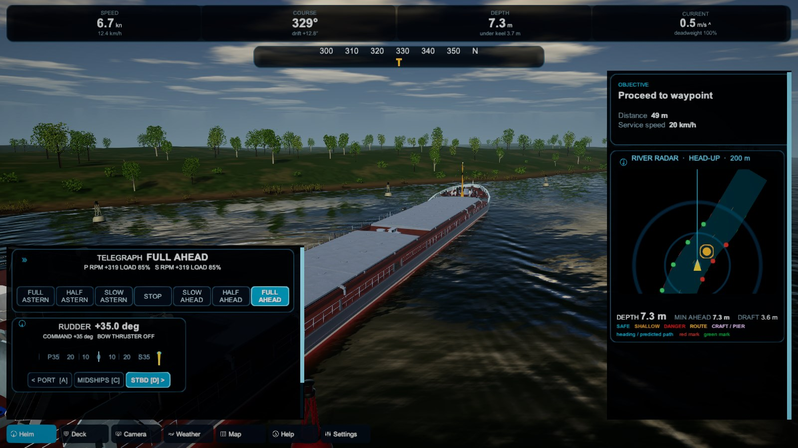

*Volgo-Don 507B in the river familiarisation passage. The current model has the
improved hull/deck, working equipment and fitted contact sections.*

| Fleet | Fleet |
|---|---|
| 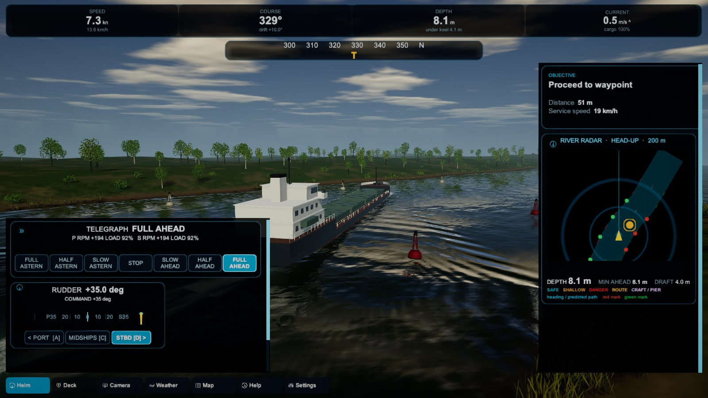 | 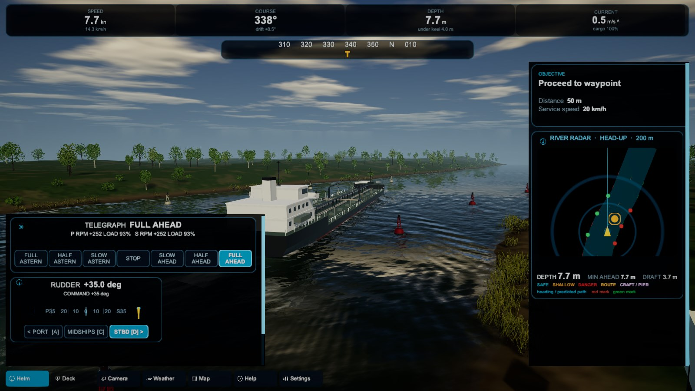 |
| Volgo-Balt: procedural dry-cargo model | Volgoneft: procedural tanker model |
| 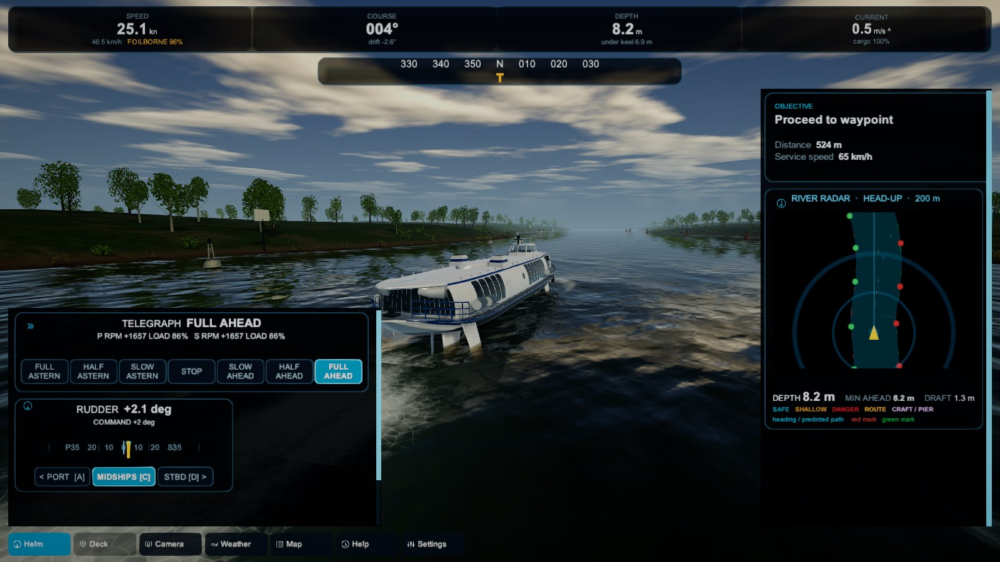 | 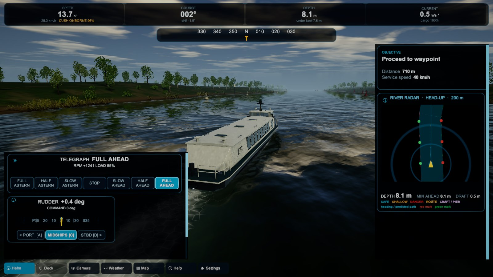 |
| Meteor: authored Blender model with foils and three LODs | Luch: authored Blender model with skegs and three LODs |
| 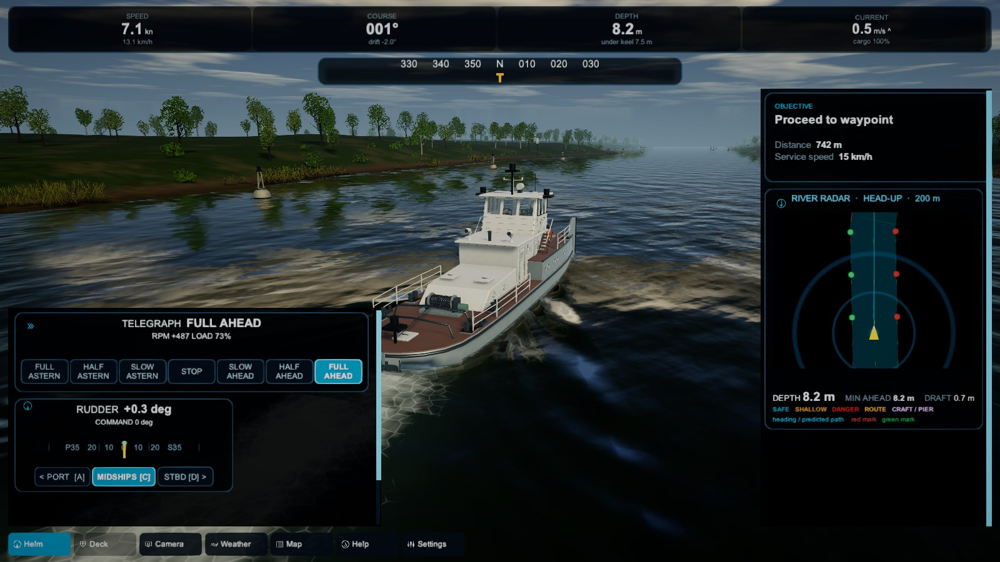 | 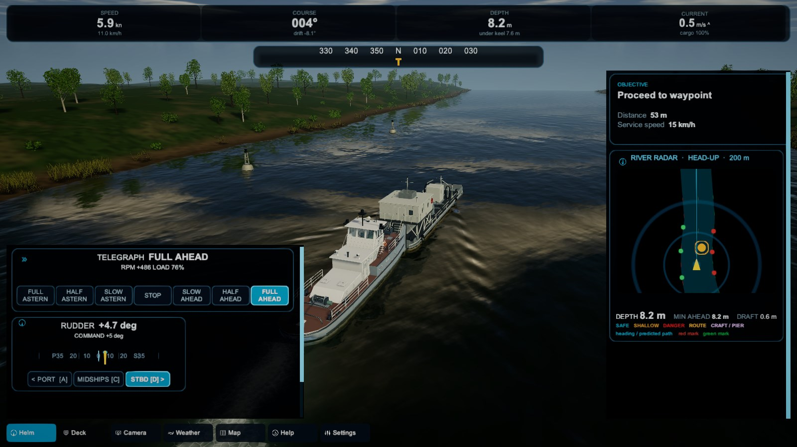 |
| Serpukhov: solo tug with estimated waterjet handling | Serpukhov + MN-52: independently simulated tug and passive barge |

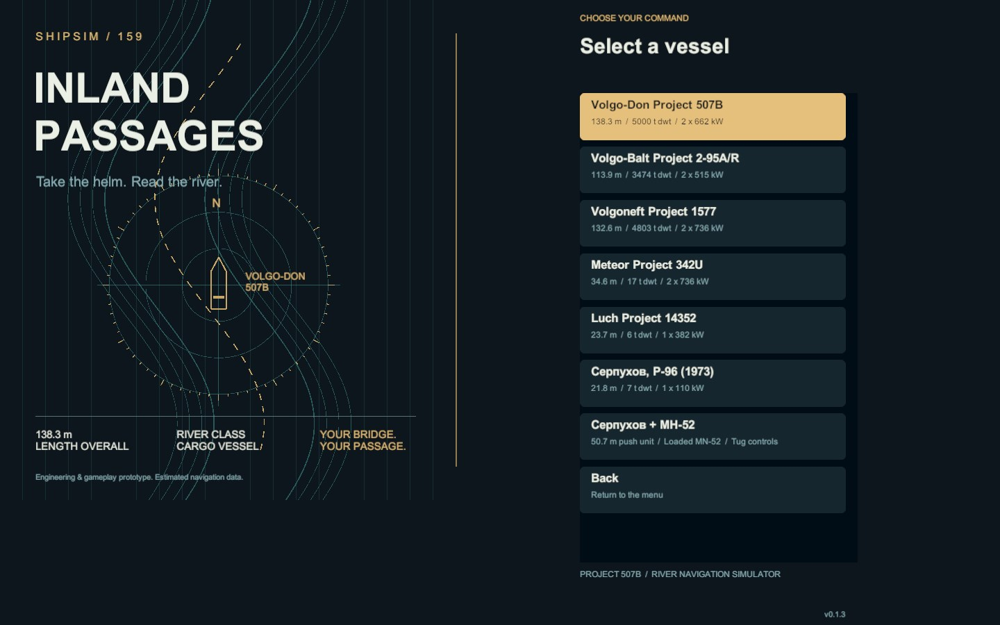

*All seven catalogue selections in the current menu.*

| Language | Settings |
|---|---|
| 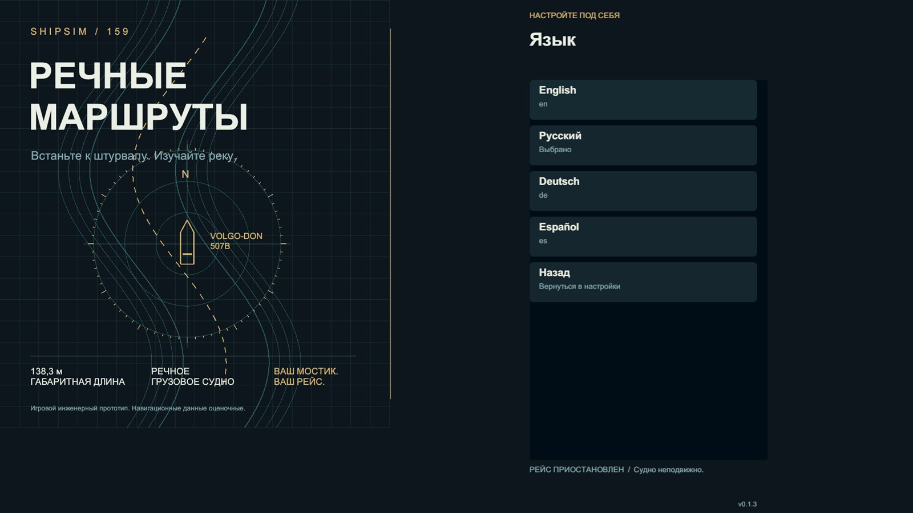 | 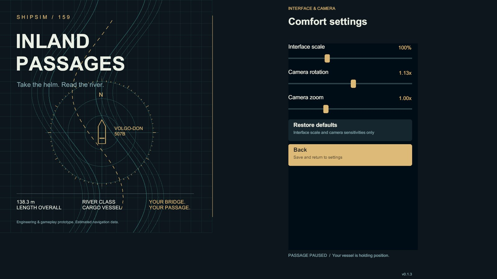 |
| Live language selection | Persistent interface scale, orbit sensitivity and zoom sensitivity |

## Fleet and model provenance

| Selection | Current model and behavior | References |
|---|---|---|
| Volgo-Don 507B | Improved editable model and three LODs; section-based hydrostatics and fitted convex contact sections; two engines and bow thruster; loading, machinery and ground tackle | [Vessel sources](VolgoDon507B_Sources.md), [integrated review](../../../Art/Source/VolgoDon507B/PART17_REVIEW.md) |
| Volgo-Balt 2-95A/R | Generated from vessel dimensions by `ProceduralVesselBuilder`; estimated superstructure/livery; two-engine dry-cargo vessel | [Sources](VolgoBalt295AR_Sources.md) |
| Volgoneft 1577 | Generated tanker with pipeline/walkway arrangement; estimated superstructure/livery; two engines | [Sources](Volgoneft1577_Sources.md) |
| Meteor 342U | Authored Blender model, materials, interior eye and three LODs; speed-dependent foil support surrogate | [Model](../../../Art/Source/Meteor342U/README.md), [physics sources](Meteor342U_Sources.md) |
| Luch 14352 | Authored Blender model, materials, interior eye and three LODs; speed-dependent cushion support and waterjet surrogate | [Model](../../../Art/Source/Luch14352/README.md), [physics sources](Luch14352_Sources.md) |
| Serpukhov R-96 | Authored Blender tug, fitted submerged sections and three LODs; estimated waterjet force surrogate | [Model](../../../Art/Source/Serpukhov_R96/README.md), [sources](SerpukhovR96_Sources.md) |
| Serpukhov + MN-52 | Tug variant coupled to a separate T-77 barge with zero actuators; 50.65 m formation, own mass/buoyancy/resistance and saved joint state | [Model and coupling](../../../Art/Source/MN52_T77/README.md), [sources](MN52T77_Sources.md) |

The barge is not an additional player ship controller. Its forces and contacts act
through its own Rigidbody. The requested centreline Serpukhov/MN-52 pairing is a
simulated arrangement, not documented historical rigging. Published particulars
and reconstruction confidence are recorded in the linked sources rather than
presented here as a validated set of ship parameters.

## Simulation, equipment and passages

The shared manoeuvring model includes added-mass acceleration, hull derivatives,
low-speed cross-flow drag, calibrated resistance, engine governors and shaft inertia,
ahead/astern propeller response, slipstream rudders, optional bow thrusters, wind
and current, estimated bank effects and shallow-water squat. Rigidbody motion is
force-driven. See [the physics model](ShipSimulator_Physics.md) and
[the dynamics approach](ShipDynamicsRealismApproach.md).

The 507B extends that model with compartment loading budgets and mass/centre-of-gravity
updates, section hydrostatics, under-hull contact and finite grounding resistance.
Open holds display nominal bulk according to actual loaded mass; empty compartments
show no heap. Hatch interlocks, animated machinery, anchor deployment/drag/heaving
and quasi-static mooring lines use existing control and save services. Shared audio
responds to vessel state; the 507B adds machinery and equipment layers. These are
estimated gameplay mechanisms, not recordings or calibrated copies of a named ship.
Commodity identity and sulphur/channel-section/grain visuals are still planned.

The three passages are:

- **Gorodets reach:** default startup, 2.27 km curved mission route, current regions,
  leading marks, shoals, estimated bathymetry, grounding/damage warnings and scoring;
  a demonstration berth supports the 507B mooring checks.
- **River familiarisation:** straight marked reach, banks and current zones, used for
  fleet shakedown and camera captures.
- **Serpukhov zaton:** 2.42 km outbound route through the lay-up basin, Nara and Oka,
  traced shoreline, approximate relief/buildings and moored-craft footprints.
  The 40 m x 10 m x 1.6 m admission limits allow Meteor, Luch and the solo Serpukhov,
  but exclude the cargo ships and the 50.65 m push unit. Fixed obstacle contacts
  cover the authored moorings; this is not a live traffic simulation.

Scenario provenance: [Gorodets plan](GorodetsScenarioTechnicalPlan.md) and
[Serpukhov sources](SerpukhovZatonScenario_Sources.md). Depths, current, buoy positions
and much of the terrain remain estimates, not a navigable survey or chart.

## Usability work

[The nine-part plan](UsabilityImprovementPlan.md) is executed one part at a time.

| Part | Current state |
|---|---|
| 1: interface/settings | Implemented: scaling, scroll/reflow, readable controls, labelled icons, independent saved preferences and input ownership. [Review](UsabilityPart1Review.md) |
| 2: localization | Implemented: four languages, 440 shared keys, live refresh and preserved UI/voyage state. [Review](UsabilityPart2Review.md), [catalogue guide](Localization.md) |
| 3: camera | Implemented and automatically verified: proportional/fractional zoom, lower orbit gain, real-time smoothing, consistent pivots, cursor lifecycle and save migration. Physical mouse/trackpad comfort assessment remains open. [Review](UsabilityPart3Review.md) |
| 4: map interaction | Complete: expanded map, bounded range/zoom/pan, follow/recenter, orientation and legend preferences, scenario routes and shorelines. [Review](UsabilityPart4Review.md) |
| 5: obstacle/buoy physics | Planned: physical buoy response and complete collision/CCD audit; existing shore/quay and hull contacts are not proof that buoys are solid |
| 6: grounded bow/water | Planned: reproduce and correct the reported 507B bow water gap |
| 7: recovery | Planned: validated safe-position recovery with explicit progress preservation; current reset is not that feature |
| 8: cargo identity | Planned: actual commodity inventory and corresponding sulphur, steel-channel and grain visuals |
| 9: integrated acceptance | Planned: combined scenarios, manual play, performance and final release acceptance |

The camera defaults to 20% closer / 25% farther per wheel tick and 0.06 degrees per
mouse pixel. Real-time smoothing is independent of 1x/2x/4x simulation speed.
Native Windows synthetic input verified the gain change; it does not establish
subjective comfort or physical trackpad behavior.

## Verification and release diagnostics

Current local verification: EditMode **325/325**, PlayMode **187/187**,
seven-selection/nine-view shakedown and menu/save-load smoke passed. The release
Windows build completed on 2026-10-28 with **0 errors and 0 warnings**; package
layout and built-player startup/voyage probes passed. The release-script fixture
suite passed **10/10**. Exact paths and scope are in
[the release diagnostics review](ReleaseDiagnosticsReview.md).

The earlier Part 3 review retains its 304/304 and 187/187 baseline and native input
measurements. A new GitHub Actions run has not been performed by the agent;
local Windows results do not replay the Ubuntu cross-compilation environment.

The linked [v0.1.3 Actions run](https://github.com/WiverNz/ShipSim159/actions/runs/40547214885)
completed and published its package, but Unity's build summary contained **3 errors
and 46 warnings**. All asset-import error annotations identified the same missing
MCP test `.meta`. A green workflow was therefore insufficient evidence of an
error-free build. The correction pins the upstream metadata fix, removes deprecated
project API calls, enables the appropriate collision pre-baking in generated assets
and their builders, and rejects builds with nonzero reported errors before packaging.
The workflow retains its build report as an artifact. It does not publish a new
release until a human commits and pushes a new release tag.

Useful checks and their scope:

| Check | What it establishes |
|---|---|
| EditMode / PlayMode | Data/configuration invariants, camera/UI ownership, save restoration, vessel motion and component regressions |
| Fleet shakedown | All seven selections get underway; nine camera captures each, support/clearance/contact checks |
| Menu smoke | Start, pause/resume, save, scenario/vessel change, load and supported equipment/loading controls |
| Localization/layout matrix | Four languages, five resolutions, three UI scales; 960 captures and clipping checks |
| Windows build and package smoke | Editor build result/error count and complete executable/data/Mono layout; file checks alone do not prove gameplay |
| Virtual sea trials | Numerical results for the estimated model; compare dated review conditions, not a historical table labelled as current |
| Native input probe | Real Windows backend units and response to synthetic mouse events; physical-device handling still needs a player |

Raw logs, test XML and full-resolution captures are local generated evidence under
`Logs/` and `TestResults/`; they are not committed. The screenshot subset above is
included in the repository for GitHub readers. Reproduction commands are in
[Tools](../../../Tools/README.md) and [release scripts](../../../scripts/README.md).

## Known limits and next work

- **Physical fidelity:** many coefficients, below-water offsets, mass distributions
  and equipment properties are estimates. Fast-craft support remains a surrogate;
  foil/cushion dynamics and waterjet transients are not resolved. PhysX contact/joint
  impulses are not a fully coupled added-mass solution. No claim of training validation.
- **507B loading/equipment:** hydrostatic table and stability limits, unresolved hold
  volume/partial-load CG assumptions, no free-surface/slosh/flooding or structural
  model; estimated machinery timings, soil and rope properties. Detailed limitations
  remain in the [integrated model review](../../../Art/Source/VolgoDon507B/PART17_REVIEW.md).
- **Models and visibility:** Volgo-Balt and Volgoneft remain procedural approximations.
  Other models have documented inferred fittings/paint/hidden geometry. The push-unit
  navigator's forward view is obstructed by the barge cabin; exterior views frame the
  combination. No general deck walking or player-facing barge detach controls.
- **Gameplay:** no AI traffic, lock operation, autopilot, AIS/ECDIS or rescue tug
  service. A playable tug and coupled passive barge exist; tug-assisted recovery does
  not. Safe-position recovery, physical buoys and cargo identity
  remain separate tasks in the usability plan.
- **Environment and graphics:** approximate scenario geography, depths and moorings;
  Serpukhov is outside some older shared graphics upgrade commands. Water optics
  Steps 0-1 are implemented; height fog/current-driven flow and RTX 3060 acceptance
  remain in [the graphics plan](GraphicsPhaseTwoPlan.md).
- **Performance and manual acceptance:** the available RTX 4090 measurements do not
  establish an RTX 3060 budget. Cold-transition frame-time tails and human handling,
  terminology and sound assessment remain open. A successful release build is not
  equivalent to completed Part 9 acceptance.
- **Input:** keyboard/mouse polling, no rebinding or gamepad, legacy Unity UI and
  telegraph layout for at most two engines.

Next implementation work is usability Part 5 when requested. Source acquisition,
calibration, real river data, scenario completion and performance validation remain
longer-term work. Use the linked reviews to distinguish completed features from
estimated behavior and outstanding acceptance.
