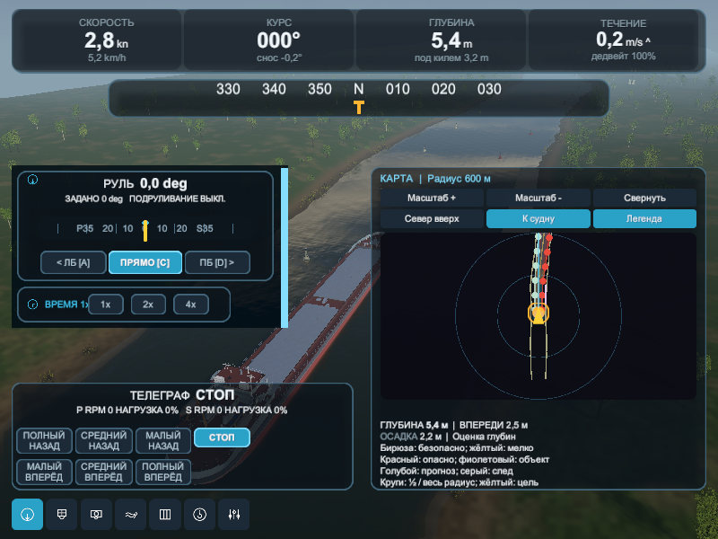
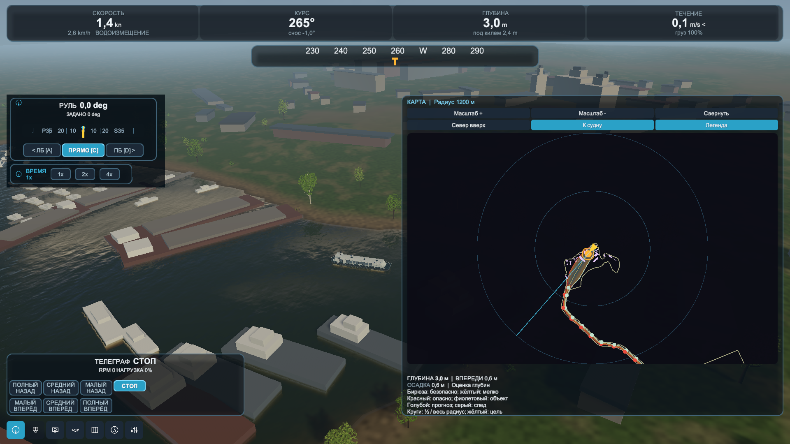

# Usability Part 4: map and navigation interaction

Implemented 2026-10-29. Part 5 buoy contact remains separate.

## Findings and changes

The old HUD used a fixed 0.82 pixel/metre projection, fixed range rings and prediction
horizon. It synthesized a short familiarisation route and buoy positions even when a
scene had its own FairwayRoute. Its viewport did not accept pointer events. Several
layers also used fixed clipping extents, which could hide lines crossing the view. Thin lines used
soft sliced sprites, causing visible gaps, and enlarged range rings inherited thick,
blurred strokes. Map lines are now solid; range rings use constant-width UI geometry.

The existing HUD and RadarChannel now share MapProjection for contacts, fairway,
shorelines, mission target, own ship, track, obstacle footprints and prediction.
The range is a bounded 100-4000 m radius, adjusted by buttons or wheel over the chart.
Expand opens the right half of the HUD without covering the permanent engine controls
or left tools. Left-drag pans the expanded map; Follow ship resumes tracking. A compact
legend and heading-up/north-up buttons are available in both sizes. Off-chart ship and
goal markers stay on the chart edge; their clamped position is an indicator, not a
new world position. Rings represent half and full selected range. Labels, footprints
and prediction horizon use current viewport scale, including reverse travel.

FairwayRoute and ScenarioBathymetry supply scenario geometry and estimated depths;
River familiarisation keeps FairwayModel. Channel centre and edge colours use sampled
depth less the vessel's physical draft. MIN AHEAD samples ahead of the ship even while
panning elsewhere. The goal comes from the mission's existing phase-distance table.
Buoy marks follow the actual scene objects, including unlit Serpukhov marks. This does
not change buoy physics. Natural-bank profiles supply the original scenes' shorelines once ShipWakeController
has created the profile (the HUD can start earlier);
Serpukhov uses the same exposed water-polygon edges as its terrain builder.
MapChartBuilder derives its resource from SerpukhovZaton.json and is called by the
scenario builder. Its north orientation uses the authored geographic bearing. The two
synthetic original scenes use world +Z as their north convention.

Map range, orientation, expanded state and legend persist in VoyageSettings. Panned
world positions are transient. Voyage restore/reset clears the track and recentres;
a new HUD for another vessel or scene starts following its ship. Clicking Follow ship
preserves the track. No save schema, ship dynamics, collision response or cargo changed.

The installed InputSystemUIInputModule normalizes scroll by
scrollDeltaPerTick; the map converts that UI value once. The camera retains a world
RMB gesture across UI until release, and map gestures cannot acquire its wheel. A left
map drag retains ownership outside its viewport, ignores other-button releases, and
clears on focus loss, menu opening or disable. Buttons use normal left-click semantics.
All new labels are translated in English, Russian, German and Spanish.

## Verification

- Full EditMode: 340/340, check-EditMode-20261029-080700-872.xml.
- Full PlayMode: 192/192, check-PlayMode-20261029-080857-941.xml.
- Additional three-scene integration/captures: 1/1, map-scenarios.xml.
- Focused map/camera/HUD/obstacle checks: 17/17, map-focused.xml.
- Layout matrix: four languages, eight resolutions from 800x600 through 3440x1440,
  three paired UI/panel scales, collapsed and expanded map with legend. Tests check
  text clipping, panel bounds, engine/map/drawer separation and ship-marker visibility.
- Scenario checks compare rendered route segments to FairwayRoute, check goal bearing,
  actual shore presence and engine separation, then capture 800x600 and 1920x1080
  views in River, Gorodets and Serpukhov. Projection/inverse, orientation, range bounds,
  persistence, moving marks, panning, recenter and reset have focused regressions.
- Fleet shakedown: check-Shakedown-20261029-081537-018.log.

Logs and full capture matrix remain under Logs/MapPart4 and Logs/Localization.
No new standalone executable or manual physical-mouse acceptance is claimed. Existing
player builds need rebuilding. Depths and geographic reconstruction remain estimated;
passing these checks does not establish real-navigation accuracy.

## Captures

Gorodets, small window:

Serpukhov, geographic north up:

