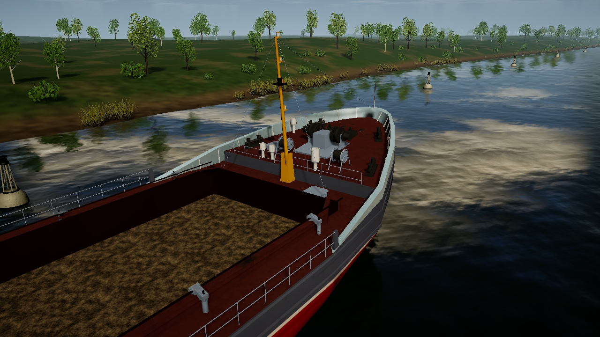
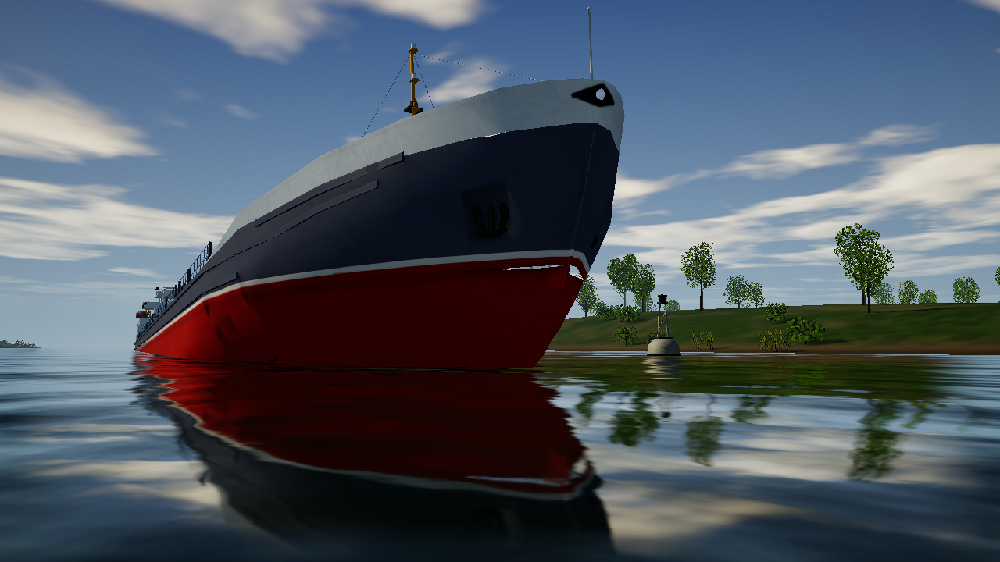
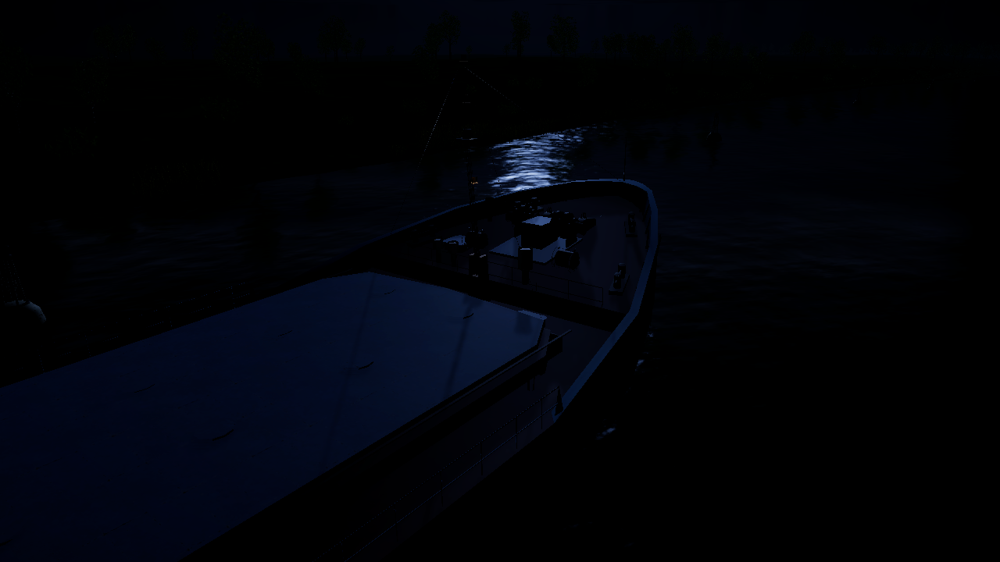

# Usability Part 6: grounded Volgo-Don bow

Completed 2026-10-30. This closes the bow rendering workstream with a reproducible
editor/player matrix and a fresh Windows build containing the earlier mesh repair.

## Demonstrated cause and ownership

The reported gap beneath the forward mast was the forecastle step wall: two
triangles per LOD faced inward, so back-face culling exposed the water behind them.
The existing [source repair review](../../../Art/Source/VolgoDon507B/BOW_STEP_REVIEW.md)
records the before/after evidence. The source blend, three FBXs and idempotent
`repair_forecastle_step.py` export step already contain that correction. Part 6
reuses it rather than adding a second wall or changing the river shader.

The regression `ForecastleWall_FacesAftAndCoversTheStepInEveryLod` and
`VolgoDonBowReview.Validate` check winding, normals and the 13.744 m² step area.
No vertex positions, colliders, hydrostatic sections or force equations changed.
No new graphic resources are required.

`HoldInteriorVisual` owns two hatch-sized stencil surfaces. `HullWaterMask` uses
bit 8 with depth testing (`ZTest LEqual`), no colour/depth writes, and draws before
water. River forward and motion-vector passes respect the same bit. These masks
do not cover the forecastle step. The demonstrated defect does not justify a
hull-wide exclusion rectangle, reflection workaround or double-sided material.

## Repeatable matrix

`BowWaterReview` is opt-in through `--shipsim-bow-review`. Ordinary voyages do
not create the fixture. A dedicated batch editor uses `BowWaterReviewLauncher.Run`;
the Windows executable runs the same runtime code. Each run records 168 PNGs at
1280 x 720 and JSON with camera, LOD, load, pose, contact force and water datum.

| Conditions | Coverage |
|---|---|
| 12 baseline states | Empty, half and full load; afloat/grounded; day/night |
| 2 additional states | Half load with asymmetric fore/aft cargo and trim; grounded, day/night |
| Each state | LOD 0/1/2; aft-facing-step, side, above and waterline views |
| Hatches | Open/closed crossed through the matrix |
| Water offset | -0.4 m by day, +0.4 m by night |

This is a pairwise diagnostic matrix, not every combination. The water offset
changes depth relative to the fixed rendered datum at y=0; it does not raise or
lower the rendered river mesh. The fixture uses an estimated analytical slope
beneath the ship in Gorodets, not surveyed bank terrain. X/Z and yaw are constrained
for repeatable views; heave, pitch and roll settle through the existing force model
for 20 simulated seconds. Grounded cases require positive bottom contact force,
and afloat cases require zero. Buoys are held kinematic only inside this fixture.

PASS proves completed captures, contact assertions and absence of runtime error
logs, not automatic pixel-level defect detection. Representative editor/player
views were inspected, including the step, empty hold, waterline, side, above,
trimmed hull and night. The original gap did not recur; no additional exterior
water cutout was identified. Night visibility is naturally limited. TAA is disabled
for these stills; temporal wake/motion-vector behavior is not newly benchmarked.

## Evidence

Historical defective step (different pose, not a pixel-matched comparison):


Current Windows player, fully loaded and grounded with open hatches:







- Compile: exit 0, `Logs/check-Compile-20261029-224859-549.log`.
- EditMode: **344/344**, `TestResults/check-EditMode-20261029-225708-760.xml`.
- PlayMode: **205/205**, `TestResults/check-PlayMode-20261030-052610-933.xml`.
- Editor: **PASS 168**, `Logs/BowWater/EditorFinal/result.txt`,
  `Logs/bow-water-editor-final.log`, process exit 0.
- Windows player: **PASS 168**, `Logs/BowWater/PlayerFinal/result.txt`,
  `Logs/bow-water-player.log`, process exit 0.
- Build: Unity 6000.6.0f1, successful with 0 build errors and 0 build warnings;
  `Logs/BowWater/Build/build-report.txt`. Unity emitted shutdown allocator diagnostics;
  these are not an assertion of a leak-free engine shutdown.
- Fresh executable: `build/BowReview/ShipSim159.exe` (development review build).
  Existing executables elsewhere are not overwritten. Launch without diagnostic
  arguments for normal play.

## Reproduce

Use a dedicated editor process with the version in `ProjectVersion.txt`, graphics
available, `-batchmode -buildTarget Win64 -projectPath <checkout>`, no `-quit`:

```text
-executeMethod ShipSimulator.Editor.BowWaterReviewLauncher.Run
--shipsim-bow-review --bow-output <absolute-output-directory> -logFile <absolute-log>
```

Build with `ShipSimulator.Editor.LocalWindowsBuild.RunBowReview` using the same
batch editor flags. Run the resulting EXE with:

```text
--shipsim-bow-review --bow-output <absolute-output-directory>
-screen-fullscreen 0 -screen-width 1280 -screen-height 720 -logFile <absolute-log>
```

Both review paths exit themselves. Use separate output directories to retain
editor and player evidence. Logs/captures/build products are ignored by Git;
the representative images above are retained with the documentation.

Part 7, recovery after grounding, remains separate and unimplemented.
