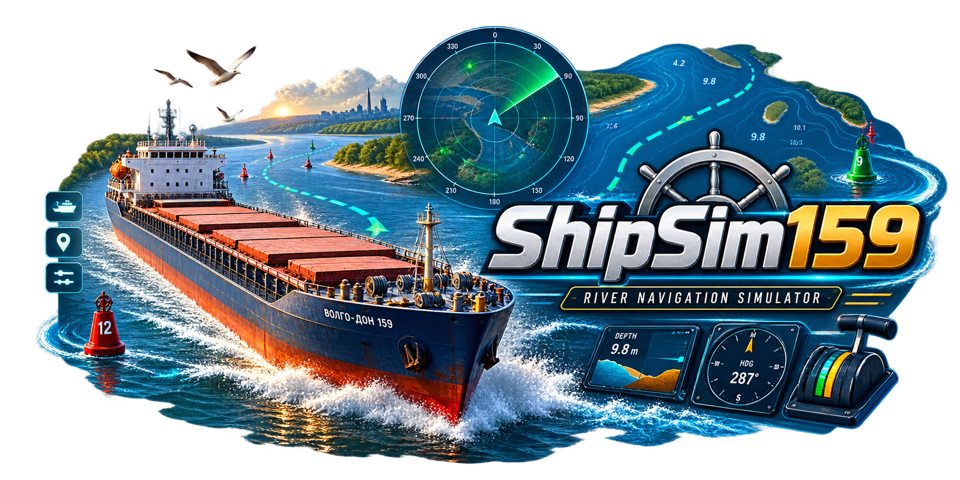

  

# ShipSim159

[English](README.md)

Прототип речного судового симулятора на Unity 6 URP. В стартовом меню доступны
шесть судов: Волго-Дон 507Б, Волго-Балт 2-95А/Р, Волгонефть 1577,
Метеор 342У, Луч 14352 и буксир Серпухов Р-96. Отдельно доступен состав
Серпухов + пассивная баржа МН-52.

Проект моделирует инерцию судна, работу двигателей и рулей, течение, мелководье,
посадку на грунт, погоду и навигацию в ограниченном фарватере. Это инженерный
и игровой прототип. Расчётные характеристики и глубины не подтверждены для
профессионального обучения или реального судовождения.

## Текущее состояние

- Параметры судов загружаются из JSON; движение рассчитывается силами и моментами
  на Rigidbody, с учётом движителей, рулей, ветра и течения.
- Три сцены: Городец, ознакомительный речной участок и Серпуховский затон.
  Последний доступен совместимым скоростным судам по ограничениям маршрута.
- Девять видов камеры, радар с фарватером, глубинами, следом и прогнозом движения.
- День и ночь, погодные эффекты, навигационные огни, отражения воды и судовые волны.
- Сохранение и продолжение рейса; настройки графики, камеры и звукового микса.
- Волго-Дон: загрузка отсеков с изменением осадки и дифферента, видимый условный
  насыпной груз, механизмы люков, якоря и швартовы.
- Общая звуковая библиотека и отдельные профили судов.
- Метеор и Луч используют авторские Blender-модели с LOD; Волго-Балт и Волгонефть
  используют процедурные модели. Волго-Дон использует доработанную подробную модель.

## Запуск

Нужен Unity **6000.6.0f1**, URP **17.6.0**, Input System **1.20.0**.
Управление рассчитано на компьютер с клавиатурой и мышью.

1. Откройте проект в Unity Hub указанной версией редактора.
2. Войдите в Play Mode. По умолчанию запускается сцена Городца.
3. В меню выберите **New voyage**, судно и маршрут либо **Continue voyage**.
4. Нажмите **Escape**, чтобы поставить игру на паузу, сохранить/загрузить рейс
   или открыть настройки.

Настройки включают звук, чувствительность камеры, качество графики,
VSync и полноэкранный режим в отдельном приложении. В разделе **Settings > Interface & camera** доступны масштаб интерфейса **80–150%**,
отдельная чувствительность вращения и зума, а также восстановление их исходных значений.
Настройки применяются сразу и сохраняются. В **Settings > Language** выберите **Русский**, **English**, **Deutsch** или
**Español**. После переключения раздел называется **Настройки > Язык**.
Перевод применяется без перезапуска и перезагрузки рейса; выбор сохраняется.

В части 3 ускорен зум: при стандартной настройке шаг колеса приближает камеру
на 20% или отдаляет на 25%. Вращение правой кнопкой стало плавнее, его базовая
чувствительность снижена вдвое. Сглаживание не зависит от ускорения времени игры.
Камера снаружи сохраняет устойчивый горизонт, а вид штурмана следует за точкой
глаза на модели. Клавиши 1–9 сразу переключают ракурс. Меню, потеря фокуса и смена
вида освобождают курсор; жесты над интерфейсом не двигают камеру. Старые сохранения
камеры поддерживаются. Подробности и ограничения проверки описаны в
[отчёте части 3](Assets/ShipSimulator/Documentation/UsabilityPart3Review.md).

Панели управления объединены во вкладки с иконками: **Helm**, **Deck**, **Camera**,
**Weather**, **Map**, **Help**, **Settings**. Длинные панели и меню прокручиваются;
Карта и управление двигателями всегда находятся в отдельных доступных областях.
Карту можно увеличить колёсиком или кнопками (радиус 100–4000 м), развернуть и
перемещать левой кнопкой мыши. «К судну» возвращает слежение. Доступны режимы
«Север вверх» / «Курс вверх» и легенда. Используются маршрут, берега, буи и цель
текущего сценария. Настройки отображения сохраняются, а загрузка рейса возвращает
карту к судну. F1 открывает справку, M открывает инструменты навигации.
Подробнее: [отчёт части 4](Assets/ShipSimulator/Documentation/UsabilityPart4Review.md).

Сборка Windows описана в [scripts/README.md](scripts/README.md), локальная сборка
и профилирование в [Tools/README.md](Tools/README.md).

## Основное управление

| Клавиша | Действие |
|---|---|
| W / стрелка вверх; S / стрелка вниз | Увеличить / уменьшить команды обоим двигателям |
| Q / Z; E / X | Команды левому и правому двигателям по отдельности |
| Пробел | Команда «Стоп» обоим двигателям |
| A / D или стрелки влево / вправо | Руль влево / вправо |
| C / Enter | Руль прямо |
| J / L; K | Подруливающее устройство влево / вправо; выключить |
| H | Звуковой сигнал |
| R | Вернуть судно в начальную позицию |
| V; 1-9 | Следующая камера; прямой выбор вида |
| Правая кнопка мыши | Вращение внешней камеры |
| Колесо мыши | Изменить расстояние камеры |
| M | Показать / скрыть радар |
| N | День / ночь |
| T; Shift+T | Скорость симуляции 1x/2x/4x; вернуть 1x |
| F2 / F3 | Сила / направление ветра |
| F4 / F5 | Дождь / туман |
| F1 | Полная справка по управлению |

Виды камеры: следование, мостик, сверху, левый борт, правый борт, нос, корма,
швартовка и место судоводителя. В последнем виде камера привязана к судну.
Подробности оборудования и управления: [OperatorGuide](Assets/ShipSimulator/Documentation/OperatorGuide.md).

## Ограничения и запланированные улучшения

Коэффициенты маневрирования, глубины и ряд физических параметров являются
оценочными. Волны и след судна визуальные. Не реализованы расход топлива,
затопление, автопилот и полноценная работа шлюзов. HUD использует Unity UI Text.

Буи имеют физические коллайдеры, массу и ограниченное усилие якорного крепления;
при ударе смещаются, а их положение сохраняется вместе с рейсом. R возвращает
судно к старту; истории безопасных позиций пока нет. Видимый груз Волго-Дона
пока представлен одним условным насыпным материалом без выбора товара.

[План улучшения удобства](Assets/ShipSimulator/Documentation/UsabilityImprovementPlan.md)
разделён на части, которые выполняются командами «сделай часть 1» и далее:

1. Читаемость, масштаб интерфейса и настройки.
2. Русский, английский, немецкий и испанский языки.
3. Плавное и предсказуемое управление камерой.
4. Масштабирование и взаимодействие с картой.
5. Физические столкновения с буями и проверка препятствий.
6. Исправление отображения воды у носа при посадке на мель.
7. Восстановление в безопасной позиции с сохранением состояния рейса.
8. Сера, стальной швеллер и зерно с отображением реальной загрузки.
9. Общие проверки и окончательное обновление документации.

Части 1 и 2 завершены. В части 3 реализованы управление и сглаживание камеры;
субъективную оценку удобства на физической мыши ещё нужно выполнить. Часть 4 завершена:
интерактивная карта проверена в трёх сценариях. Часть 5 добавляет физические буи:
они смещаются при ударе, возвращаются к месту стоянки и сохраняют положение вместе
с рейсом. Части 6–9 запланированы.
[Проверки и ограничения части 5](Assets/ShipSimulator/Documentation/UsabilityPart5Review.md).
Изменения и проверки описаны в [отчёте части 1](Assets/ShipSimulator/Documentation/UsabilityPart1Review.md)
и [отчёте части 2](Assets/ShipSimulator/Documentation/UsabilityPart2Review.md).
Проверки части 2: EditMode 289/289, PlayMode 176/176; семь вариантов судов
и сохранение/загрузка проверены. Получены 960 снимков интерфейса на четырёх языках.
Причины, которые подтверждены исходным кодом,
отделены в плане от симптомов, требующих воспроизведения в игре.

## Проверки и документация

Тесты запускаются через **Window > General > Test Runner** или общие скрипты
из [Tools/README.md](Tools/README.md). Для PlayMode требуется включённый рендеринг.
Последние записанные результаты до работ по удобству, 25.10.2026:
EditMode **269/269**, PlayMode **161/161**. Это не проверка будущих исправлений.

- [Состояние проекта](Assets/ShipSimulator/Documentation/ProjectStatus.md)
- [Каталог документации](Assets/ShipSimulator/Documentation/README.md)
- [Физическая модель](Assets/ShipSimulator/Documentation/ShipSimulator_Physics.md)
- [Проверка столкновений Волго-Дона](Art/Source/VolgoDon507B/PART16_REVIEW.md)
- [Итоговая проверка модели](Art/Source/VolgoDon507B/PART17_REVIEW.md)
- [Производительность приложения](Art/Source/VolgoDon507B/PLAYER_PERFORMANCE.md)
- [Правила работы с проектом](AGENTS.md)

Изменения генерируемых сцен и моделей следует вносить в соответствующие
сборщики и интеграторы, иначе следующая генерация их перезапишет.
Каталоги Library, Temp, Logs и UserSettings не включаются в исходники.

Проверки части 3: EditMode **304/304**, PlayMode **187/187**; прогон семи вариантов
судов по девяти ракурсам и проверка меню/сохранений прошли. Собрана версия Windows
для проверки: `build/CameraReview/ShipSim159.exe`. Системный ввод подтвердил новый
отклик; оценка удобства физической мышью или трекпадом остаётся за игроком.
